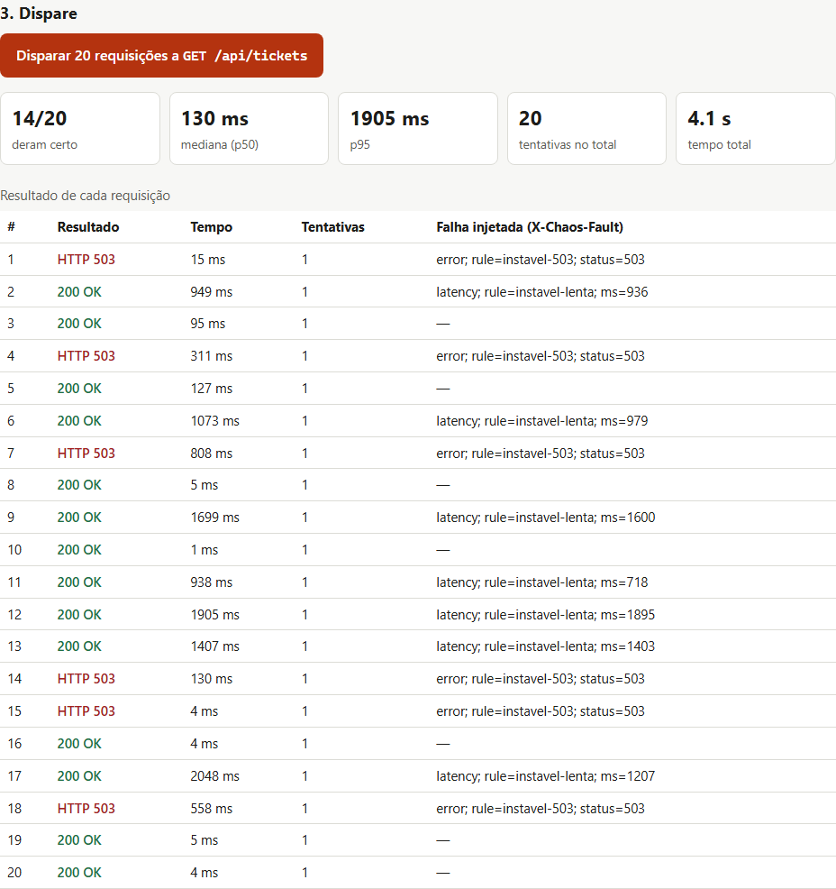
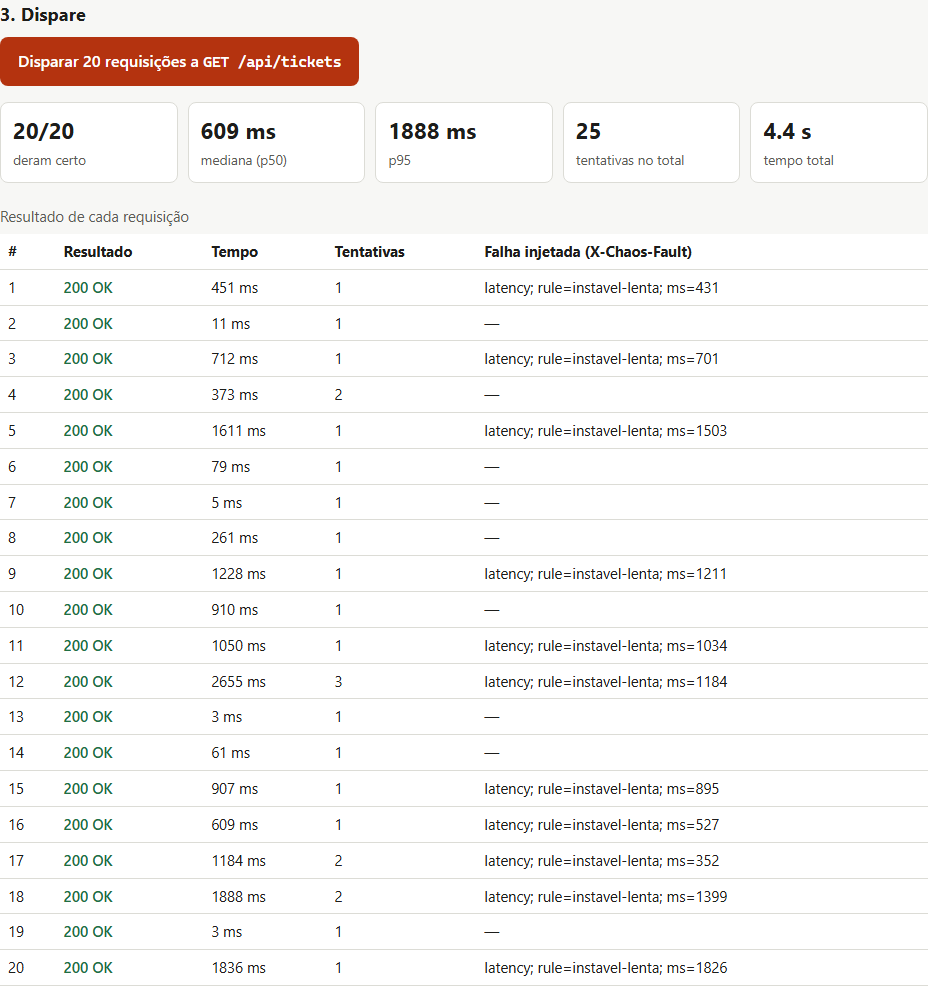

# Chaos Proxy

Proxy reverso em .NET 10 + YARP que fica entre um cliente e uma API e injeta falhas de propósito (lentidão, timeout, erro 5xx, `429` com `Retry-After`, conexão derrubada e HTML no lugar de JSON) para medir, com números, se o cliente aguenta.

**Demo:** [chaos-proxy.onrender.com](https://chaos-proxy.onrender.com): escolha um cenário (vale só para você) e compare um cliente ingênuo com um resiliente. O plano grátis do Render dorme sem visitas, e a primeira leva uns 30 s para acordar.

Foi feito para o [Portal de Chamados](https://github.com/AdemarChamiNeto/portal-chamados) e a [API de Chamados](https://github.com/AdemarChamiNeto/api-chamados): com ele na frente da API, o Portal ganhou novas tentativas, `Retry-After` e circuit breaker, e no caminho apareceram dois bugs reais (ver [Decisões](#decisões)).

<p>
  
  
</p>

O mesmo cenário ("API instável": 20% de 503, 10% de queda de conexão, 30% de lentidão) com o cliente ingênuo, à esquerda (**14/20**), e com o resiliente, à direita (**20/20**, com 24 tentativas).

**Stack:** C# 14 · **.NET 10** · ASP.NET Core (minimal APIs) · **YARP** · OpenAPI · **xUnit** + WebApplicationFactory · Docker · Render

## Funcionalidades

- **Tudo que não começa com `/_chaos` é repassado para a API** (`UPSTREAM_URL`). Sem ela, o proxy usa uma **API de demonstração embutida** e abre funcionando.
- **Seis tipos de falha**, configuráveis por regra:

  | Tipo | O que acontece |
  |---|---|
  | `latency` | atrasa de X a Y ms e depois repassa |
  | `timeout` | segura a resposta (até 30 s) e devolve 504: o cliente deve desistir antes |
  | `error` | responde 4xx/5xx em JSON, no formato da API de Chamados |
  | `htmlError` | responde a página de erro de um nginx (o tipo de resposta que quebra quem espera JSON) |
  | `rateLimit` | depois de N requisições na janela, `429` com `Retry-After` |
  | `drop` | derruba a conexão sem resposta |

- **Regras por rota, método e probabilidade:** `/api/tickets/*`, `POST`, 20%… A primeira que casar e passar no sorteio decide.
- **Sete cenários prontos:** normal, lenta, instável, fora do ar, travada, rate limit e HTML no lugar de JSON.
- **Toda falha injetada sai marcada** com o cabeçalho `X-Chaos-Fault` (`error; rule=fora; status=503`). Uma falha *real*, como a API fora do ar, vira `502` sem ele.
- **Administração** (`/_chaos/rules`, com token): troca as regras globais, que valem para todos os clientes (ex.: o Portal).
- **Demonstração pública sem atrapalhar ninguém:** cada visitante escolhe o cenário só para a própria sessão (cookie `httpOnly`, 1 h). A página compara um cliente ingênuo com um resiliente.
- **Log** das últimas 200 requisições: o administrador vê tudo, o visitante só as próprias. Não guarda query string nem cabeçalhos.
- **Rate limit em todas as rotas**, com `429` e `Retry-After`:

  | Rotas | Limite por IP |
  |---|---|
  | leitura em `/_chaos` | 120 / min |
  | escrita em `/_chaos` (regras, sessão) | 30 / min |
  | token de administração errado | 5 / 15 min, depois bloqueio |
  | requisições repassadas à API | `PROXY_RATE_LIMIT` (padrão 600 / min) |

## Arquitetura

```
src/
  Chaos.Domain/            regra pura: não conhece HTTP nem ASP.NET
    FaultRule.cs           tipos de falha e a regra
    RuleValidator.cs       validação campo a campo (o que a API devolve em 422)
    PathPattern.cs         rota com segmentos, * e ** (sem regex)
    ChaosEngine.cs         decide a falha; sorteio, relógio e contador da janela injetáveis
    Scenarios.cs           cenários prontos
  Chaos.Proxy/
    Program.cs             composição, cabeçalhos de segurança, rotas
    ChaosHandler.cs        aplica a decisão e repassa para a API
    Upstream.cs            YARP (API real) e a API de demonstração embutida
    AdminEndpoints.cs      /_chaos: saúde, cenários, sessão, log e regras (token)
    RateLimits.cs          limites do próprio proxy
    ChaosSettings.cs       variáveis de ambiente validadas na subida
    wwwroot/               página da demonstração
tests/
  Chaos.Domain.Tests/      rotas, validação, sorteio, janela do rate limit
  Chaos.Proxy.Tests/       o app inteiro em memória + uma API real numa porta para o YARP
docker-compose.yml         MySQL + API de Chamados + proxy (o Portal roda fora, apontando para ele)
```

### Decisões

- **O domínio decide; o ASP.NET só aplica.** `ChaosEngine.Decide` recebe método, rota, cliente e regras e devolve uma decisão (`Forward`, `Respond`, `Hold`, `Drop`). Sorteio e relógio são injetados, então "20% de erro" e "janela de 5 s" são testados sem sorte e sem esperar.
- **Falha injetada nunca se confunde com falha real.** Toda resposta injetada leva `X-Chaos-Fault`. Se a API cair de verdade, o proxy responde `502 upstream_unavailable` sem o cabeçalho.
- **Regras trocadas por referência.** `RuleSet` é imutável; trocar as regras é trocar a referência (`Volatile.Write`). Uma requisição nunca vê metade das regras antigas e metade das novas.
- **Rota sem regex, e sem o problema da regex.** Padrão vindo de fora numa regex pode travar o servidor (ReDoS), então a rota é casada por segmentos. Ao escrever o teste do pior caso, o meu próprio casamento com vários `**` se mostrou exponencial; agora ele memoriza os pares que já falharam e o teste roda na hora.
- **Cenário por visitante na demo pública.** Se o cenário fosse global, um visitante derrubaria a demo de todo mundo. Cada um tem o seu, guardado num cache com tamanho máximo e expiração. Regras livres, só com o token de administração.
- **Recursos que não podem esgotar:** no máximo 100 requisições "travadas" ao mesmo tempo (depois, 503 na hora); log com 200 linhas; contador de rate limit com no máximo 10 mil chaves.
- **X-Forwarded-For.** O proxy informa o IP de quem o chamou. A API só deve confiar nesse cabeçalho se souber que está atrás do proxy; a API de Chamados usa só o `REMOTE_ADDR`, o que está certo, mas significa que o rate limit por IP dela passa a ver um IP só (o do proxy). O mesmo vale para o proxy no Render: ele só lê o `X-Forwarded-For` com `TRUST_FORWARDED_HEADERS=true`.
- **Arquivos da demo por endpoint, com lista fechada.** A rota pega-tudo do proxy casaria antes do `UseStaticFiles`; servir os três arquivos por nome evita isso e impede que um caminho vindo da URL chegue ao disco.
- **O que ele achou:**
  - **API de Chamados:** na imagem Docker (Apache + mod_php) o cabeçalho `Authorization` não chegava ao PHP, e toda rota com token respondia 401. Os testes usam o servidor embutido do PHP, por isso nunca pegaram. Corrigido com um `SetEnvIf` no Apache.
  - **Portal:** uma resposta `200` com HTML era tratada como sucesso com dados nulos; e, em produção, o Next.js trocava a mensagem de erro por um texto genérico. Os dois foram corrigidos junto com a resiliência.

## Resultado no Portal

`scripts/caos.ts`, no repositório do Portal, dispara 30 consultas em cada cenário com o cliente antigo (uma tentativa, timeout de 8 s) e o atual (novas tentativas em GET, `Retry-After`, circuit breaker). Números de uma rodada:

| Cenário | Antes | Depois |
|---|---|---|
| API instável | 20/30 | **30/30** |
| HTML no lugar de JSON (50%) | 14/30 | **26/30** |
| API travada | 80 s esperando timeouts | **25 s**, com menos da metade das chamadas |
| API fora | 30 chamadas inúteis | o circuito abre e o usuário vê o aviso na hora |
| Rate limit (`Retry-After` até 5 s) | 5/30 | 5/30: de propósito, a página não espera mais de 2 s |

A primeira versão do circuit breaker contava cada tentativa como falha, e a tabela mostrou o problema: no cenário de HTML o resultado *piorava* (12 → 11), porque o circuito abria à toa. Contando o resultado de cada requisição, foi para 26/30. Os detalhes estão no [README do Portal](https://github.com/AdemarChamiNeto/portal-chamados#decisões).

## Rodando

Precisa do .NET 10.

```bash
dotnet run --project src/Chaos.Proxy        # http://localhost:5080/_chaos, modo demonstração
```

Com a API de Chamados de verdade na frente (precisa do repositório `api-chamados` ao lado deste):

```bash
docker compose up -d                        # MySQL + API na 8080 + proxy na 8081
cd ../portal-chamados && CHAMADOS_API_URL=http://localhost:8081 npm run dev
```

Trocar o cenário de todo mundo (token em `CHAOS_ADMIN_TOKEN`; no compose há um token local de desenvolvimento):

```bash
curl -X PUT localhost:8081/_chaos/rules/scenario/instavel -H "Authorization: Bearer $CHAOS_ADMIN_TOKEN"
curl -X PUT localhost:8081/_chaos/rules -H "Authorization: Bearer $CHAOS_ADMIN_TOKEN" -H "Content-Type: application/json" \
  -d '{"rules":[{"name":"post-lento","kind":"latency","method":"POST","path":"/api/tickets","delayMinMs":2000,"delayMaxMs":3000}]}'
curl -X DELETE localhost:8081/_chaos/rules -H "Authorization: Bearer $CHAOS_ADMIN_TOKEN"
```

A documentação das rotas de controle fica em `/_chaos/openapi.json`.

## Testes

```bash
dotnet test        # 67 testes: 45 do domínio e 22 do proxy inteiro
```

- **Domínio:** rotas com `*` e `**` (inclusive o pior caso de curingas), validação campo a campo, sorteio nos limites (0, 0,2, 1), faixa de latência, ordem das regras, filtro por método, janela do rate limit por cliente com o relógio avançando, contador que não cresce para sempre.
- **Proxy:** modo demonstração, cabeçalhos de segurança, arquivos só da lista, token (e o bloqueio depois de 5 erros), cenário global e por sessão, `422` com o campo, `400`/`413`/`415`, cada tipo de falha (HTML, `429` com `Retry-After`, `504`, conexão derrubada, cliente que desiste), repasse pelo YARP para uma API real numa porta (caminho, query, `X-Forwarded-For`, cookie da demo e `X-Chaos-*` removidos), API fora → `502` sem marca, limite do próprio proxy e toda rota de controle no OpenAPI.
- **Configuração:** em produção não sobe sem token; junta todos os problemas numa mensagem, sem mostrar os valores.

## Deploy (Render)

No ar em [chaos-proxy.onrender.com](https://chaos-proxy.onrender.com), sem banco: regras, sessões e log ficam em memória (com limite) e zeram quando o serviço reinicia.

1. **New + → Blueprint** → este repositório (`render.yaml`).
2. O `CHAOS_ADMIN_TOKEN` é gerado pelo Render. Sem `UPSTREAM_URL`, a demo pública usa a API embutida.
3. Saúde em `/_chaos/health`.

## Autor

Ademar C. Neto · [portfólio](https://ademarchamineto.github.io) · [GitHub](https://github.com/AdemarChamiNeto)
